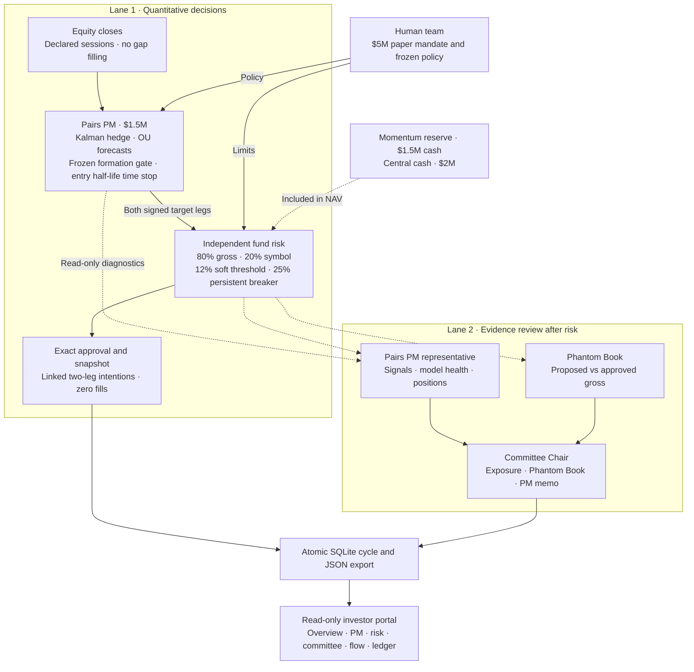
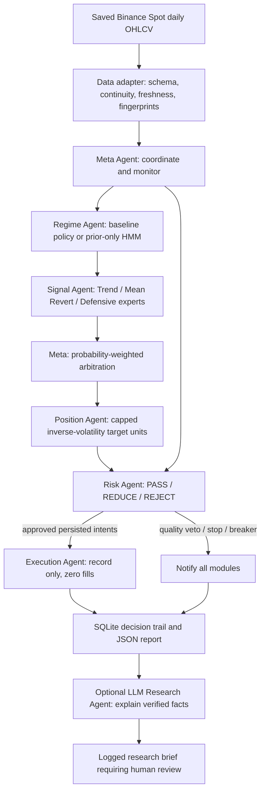

# Pairs fund architecture

Updated 17 October 2026. Pairs is the only connected PM. The teammate's pinned
Kalman, OU, forecasting, and formation engines run through `fund_agents/pairs.py`.
The active package does not import the legacy Crypto engine or its risk state.

## Human AI and code ownership

The human team owns strategy definitions and risk policy. Deterministic code
computes targets, enforces risk, and saves intentions. The advisory lane reviews
evidence after the quantitative decision and has no order authority.



## Strategy integration

The upstream revision remains `5d42b04` as checked on 17 October. Four numerical
files are pinned in `vendor/pairs_trading/SOURCE.json` and checked against their
recorded local hashes for each proposal. Saved diagnostics include source,
revision, effective policy, and configured pairs. The default research pair is
V/MA on XNYS in USD; further pairs require declared calendars, currencies, and
validated data. The upstream ensemble and crypto candidates are not connected.

Formation through 31 December 2024 gates research entries with upstream
cointegration, correlation and half-life thresholds. The adapter blocks
unqualified fallback entries, extreme divergence, and invalid OU estimates.
It corrects residual forecast standardization and preserves signed beta.
Confirmed opening sessions determine a frozen OU half-life time limit:
`min(45, max(1, ceil(2.5 × entry_half_life)))`; invalid entry estimates use the hard cap.
Future price rows cannot change a prior signal. Missing required sessions hold
the cycle. Closed-market holdings retain confirmed units without a new trade.

Fund risk counts symbol gross across pair groups before netting. A common scale
preserves both signed dollar legs. Capital, collateral, and fee reserves can
bind before the fund cap. The Phantom Book measures exposure reductions, not
counterfactual profits. Supplied cash and confirmed holdings determine NAV;
recorded intentions do not change the account or generate returns.

## Momentum strategy (standalone)

`momentum/` is a separate paper strategy: a 50% long/short trend sleeve plus a 50% long-only risk-parity core over 21 assets,
volatility-targeted with walk-forward GARCH(1,1)-t forecasts. It has its own inputs (`data/momentum/`), daily update
(`scripts/run_momentum_daily.py`), outputs (`live/momentum/`, `reports/momentum/`) and tests. It is not connected to `fund_agents`: the
fund risk layer models two-leg pair groups with an 80% gross cap, while this strategy runs up to 3x gross long and short. Connecting
it as the Momentum PM would need a single-asset target type and a leverage policy in `fund_agents/models.py` and `risk.py`. See
[momentum/README.md](momentum/README.md).

## Persistence and investor access

New accounts and stores are separate from old two-PM state. Reports use
`pairs-fund-v2`; the active portal indexes only that schema with exactly the
Pairs PM. Old JSON and SQLite records remain historical on disk. An old cycle
link falls back to an indexed current cycle. Legacy portfolio/config fields are
rejected instead of silently reassigning existing holdings.

`python -m fund_agents` runs the synthetic demo. `python -m fund_agents.dashboard`
serves the localhost GET-only portal. The [run guide](fund_agents/README.md)
documents historical input, account schema, optional imported replies, and exports.
Default tools and summaries do not call an LLM. Imported replies must bind to
facts digests and match structured metric claims; narrative needs human review.

The next engineering milestones are linked-leg fill handling, quote/lot and
borrow checks, costed and reconciled accounting, provider integration, hosted
investor access, and a separately validated Momentum engine. Forward performance
evidence remains necessary before making an investment case.

## Archived standalone research

The following sections describe earlier crypto research retained for history.
They are not part of the active architecture above.

## Existing crypto infrastructure from 9 October 2026

Implemented 9 October 2026. The structure follows the supplied BURSA architecture:
one local Python process with explicit ownership, typed messages, a final Risk
veto, persisted state, and record-only Execution. Existing research models and
the separate daily paper-account workflow remain available.



Meta calls each module in order. Signal specialists do not submit orders. Position
only proposes. Risk approves, resizes or rejects; Meta cannot override its decision.
Execution verifies that the exact Risk decision is persisted before recording an
intent. A raw order or modified approval is rejected.

## Existing capabilities fitted into agents

| Module | Reused capability | Phase-1 behavior |
|---|---|---|
| Data adapter | Binance daily files; existing public client and archive loader | Audit exact local bytes; preserve gaps and labels |
| Meta | Existing daily orchestration concepts | One atomic SQLite cycle, notifications and report |
| Regime | `GaussianHMM2`, stationary return/volatility features | Baseline: trend-only policy. Optional experiment fits strictly before inference |
| Signal | Existing adaptive SMA and Sharpe gate | Trend expert, simple holdings-aware Bollinger expert, defensive cash expert |
| Position | Existing capped inverse-volatility sizing | Long-only fractional crypto units, next-period target proposal |
| Risk | Existing exposure/volatility constraints | Independent caps, fee/cash budget, prior-ADV liquidity cap, stops and latched drawdown breaker |
| Execution | Explicit BURSA-style boundary | Idempotent intent records; no fills or portfolio changes |
| LLM Research | Wayland Lesson 14 research boundary | Optional imported structured reply; no provider call or order authority |

`config/agents.research.json` retains the assignment's adaptive strategy. Its
Regime Agent explicitly declares a policy with 100% trend routing; those weights
are not HMM probabilities. `config/agents.hmm_experiment.json` enables a separate
unvalidated routing experiment: high volatility -> trend, low volatility -> mean
reversion, defensive weight zero. Volatility does not establish a crisis. The
new architecture and HMM blend have no newly measured performance claims.

## Data engineering gate

`crypto_quant/data_quality.py` checks required columns, explicit timezone offsets,
finite positive prices, OHLC ordering, volume bounds, integer trade counts, unique
ordered timestamps, UTC interval alignment, completed candle boundaries,
continuous 24/7 coverage, minimum history and the expected last completed bar.
Zero-volume decision bars block proposals. Large moves and older zero-volume bars
are preserved as warnings. No gap filling, duplicate removal or price repair is
performed by the gate.

The local agent adapter audits all available rows through the requested date and
explicitly counts future rows excluded for historical replay. It reads each file
once and fingerprints those exact bytes. A failed file supplies no usable bars;
Risk vetoes the cycle. Audit and snapshot hashes bind reports to inputs. These are
structural checks, not independent verification of the venue, listing history,
survivorship, bid/ask liquidity, or revised data. The existing daily public runner
also verifies listing dates before this gate.

`run_daily_pipeline()` now writes `live/data_quality.json` before any portfolio
processing and refuses stale or corrupt input. On quality failure it leaves
portfolio ledgers unchanged; the quality file records the failed attempt even if
an older successful run manifest still exists. The public client rejects duplicate
or unordered candles rather than silently dropping them.

Future runs of `scripts/prepare_klines.py` add per-dataset quality sidecars,
normalized-output SHA-256 hashes, raw-archive fingerprints and per-dataset checksum
verification flags. Existing processed files/manifests have not been regenerated.
Known hourly gaps remain visible and can cause a structural FAIL; checksum success
does not make a gapped window suitable for a continuous daily model.

## State and risk boundaries

- Frozen dataclasses carry snapshots, routing, signals, proposals and decisions.
- SQLite cycle/events/decisions/intents tables reject UPDATE and DELETE through
  triggers. Mutable account state holds the breaker. This is operational logging
  inside a trusted process, not external tamper-proof storage.
- A transaction covers approvals, intent records, breaker state and event history.
  A crash before commit rolls the cycle back. JSON exports can be recovered from
  SQLite if exporting fails after commit.
- Intent identities are derived from inputs, portfolio and policy. Repeating an
  unchanged proposal in one account produces `ALREADY_RECORDED_NOT_EXECUTED`.
- Risk uses supplied cash for buys. Planned sale proceeds are never treated as
  available cash. Prior-day trailing quote-volume ADV caps order notional; that
  cap is a research estimate, not an order-book fill model.
- The configured volatility target is estimated by Position from historical
  covariance; it is not a guaranteed future-volatility ceiling.
- Stops and take-profit thresholds generate exit requests. No requested exit is
  a promised fill. The drawdown breaker survives restarts and has no automatic
  reset. A separate account key/database is required for an independent replay.
- Unknown active specialist inputs hold the proposed portfolio. Independently
  triggered Risk exit requests can still be recorded on valid data.
- The agent CLI never changes `live/paper_state.json`, positions, cash, P&L or
  the assignment CSV. The existing daily runner remains the paper-fill workflow.

## LLM role

Following [Wayland Zhang, Lesson 14](https://waylandz.com/quant-book-en/Lesson-14-LLM-Applications-in-Quant/),
LLM research runs after quantitative decisions. It receives computed facts and a
digest, and may return a summary, observations, risk flags, suggested experiments
and copied metric claims. Each claim must match an input metric. Raw reply, parsed
output, claimed model identity, prompt version, facts, timestamp and result are
logged. Free-text claims and causality require human review. No LLM API integration
or model execution is claimed in this phase; imported replies are explicitly
optional and the model name is supplied by the caller.

To supply a reply, take `llm_research.input_facts`, `input_sha256` and `system_prompt`
from a run report. Save a response envelope under ignored `local_llm/`:

```json
{
  "model": "your-provider-model-id",
  "input_sha256": "digest-from-the-report",
  "output": {
    "summary": "Research summary for human review",
    "observations": [],
    "risk_flags": [],
    "suggested_research": [],
    "metric_claims": [{"name": "filled_orders", "value": 0}]
  }
}
```

Pass `--llm-response local_llm/reply.json` to an otherwise identical cycle. A
schema, digest or metric mismatch is logged as `REJECTED`; execution decisions
are unaffected. The default report says `NOT_REQUESTED`, not an invented LLM brief.

## Run locally

```powershell
.\.venv\Scripts\python.exe -m crypto_agents --config config/agents.demo.json
.\.venv\Scripts\python.exe -m crypto_agents --config config/agents.demo.json --scenario reduce
.\.venv\Scripts\python.exe -m crypto_agents --config config/agents.demo.json --scenario flagged
.\.venv\Scripts\python.exe -m crypto_agents --config config/agents.demo.json --scenario breaker
.\.venv\Scripts\python.exe -m crypto_agents --config config/agents.research.json --data-dir live/market_data --as-of 2026-09-16
.\.venv\Scripts\python.exe -m unittest discover -s tests -v
```

The September date is an explicit historical replay of the current cached daily
files. It does not claim current October coverage. Research runs use an empty
hypothetical portfolio unless `--portfolio local_portfolios/snapshot.json` is
supplied. Required portfolio fields: `as_of`, `cash_usdt`, `peak_equity_usdt`, and
`holdings` containing `symbol`, `units`, `entry_price`. Dates must match the market.

Audit current freshness without changing local data:

```powershell
.\.venv\Scripts\python.exe scripts/audit_market_data.py live/market_data/BTCUSDT_1d.csv live/market_data/ETHUSDT_1d.csv --closed-at 2026-10-09T00:00:00Z --expected-last 2026-10-08 --minimum-rows 520
```

Status codes: 0 for a completed inspection/intent cycle; 2 for quality/risk veto,
breaker or input hold. Runtime state and per-cycle reports are ignored by Git.
The verified test/evidence summary is in `reports/agents/implementation_report.md`.

Deferred: direct LLM provider integration, authenticated exchange execution,
multi-process permissions, continuous monitoring, and a new agent-strategy
backtest. The assignment's October paper run must be activated separately.
