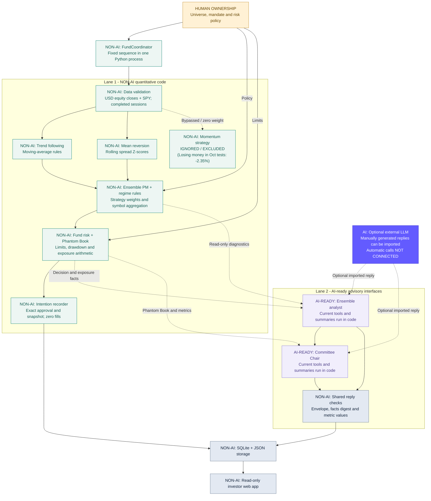

# Ensemble fund architecture

Updated 20 October 2026. One Ensemble PM replaces the retired standalone
Kalman/OU Pairs PM. It runs the teammate's trend, momentum and mean-reversion
engines from `multi_strategy_ensemble/` through independent fund risk.

[Slide diagram](presentations/architecture_20261020/ensemble_architecture.html) ·
[SVG](presentations/architecture_20261020/ensemble_architecture.svg) ·
[PNG](presentations/architecture_20261020/ensemble_architecture.png) ·
[PDF](output/pdf/Ensemble_Fund_Architecture_20261020.pdf)

## Human AI and code ownership

The human team chooses the universe, capital budgets, allocation method and risk
limits. Lane 1 computes targets and records risk-approved intentions. Lane 2
reviews the saved evidence after risk, with no authority to change the portfolio.
The default mandate combines the previous strategy budgets into USD 3 million
for the ensemble and retains USD 2 million in central cash.

### Which parts use AI

| Component | Current implementation | AI status |
| --- | --- | --- |
| Human policy owners | Select mandate, universe and risk policy | Human judgment |
| FundCoordinator | Calls the modules in a fixed sequence | Non-AI code |
| Data gate | Validates required sessions and numerical values | Non-AI code |
| Three strategy engines | Moving averages, rankings and spread Z-scores | Non-AI quantitative rules |
| Regime detector and Ensemble PM | Threshold classifier, allocation and aggregation | Non-AI code |
| FundRisk and Phantom Book | Limits, scaling, breaker state and exposure differences | Non-AI code |
| Analyst and Committee Chair | Read-only diagnostic tools and computed summaries | AI-ready interfaces; no automatic model calls |
| Optional external LLM | Can generate commentary outside this runner for manual import | AI-generated input, when supplied |
| ResearchAgent reply checks | Schema, digest and structured metric comparisons | Non-AI validation code |
| Intention recorder, database, JSON and web app | Persistence and read-only display | Non-AI infrastructure |

The current default pipeline performs no automatic LLM inference. An agent role
name does not mean a model ran. The analyst and Chair can accept imported model
commentary, while all default tools and summaries execute ordinary Python code.
Their outputs cannot modify targets, override risk or place orders. Current
role separation is implemented through interfaces inside a trusted process.

## Bruce Tech design reference and proposed extension

The [Bruce Tech public site](https://bruce-tech.com/) describes Manifest MX5 as
one engine requiring agreement between tension, momentum and structure readings.
It also lists Safe Harbor with a 7% maximum-drawdown halt and Ride the Waves with
a 15% halt. These are attributed reference descriptions, not features verified
in or imported into this repository.

[Proposed-extension diagram](presentations/architecture_20261020/bruce_inspired_proposal.html) ·
[PNG](presentations/architecture_20261020/bruce_inspired_proposal.png) ·
[Editable SVG](presentations/architecture_20261020/bruce_inspired_proposal.svg) ·
[PDF](output/pdf/Bruce_Inspired_Architecture_Proposal_20261020.pdf)

| Idea | Relevance to Meridian | Implementation status |
| --- | --- | --- |
| Regime adaptation | The existing classifier changes allocation weights by market state | Implemented as deterministic rules |
| Three readings must agree | A possible admission gate for one signal engine; different from blending three strategy portfolios | Proposed; no tension/structure metrics or agreement gate implemented |
| One engine, two envelopes | Separate investment logic from the investor's risk mandate | Useful design pattern; named profiles are not configured |
| Safe Harbor 7% halt | Example tighter drawdown policy attributed to Bruce Tech | Reference only; not the current fund threshold |
| Ride the Waves 15% halt | Example wider drawdown policy attributed to Bruce Tech | Reference only; not the current fund threshold |

The envelopes are **risk profiles**, not instruments. Instruments are assets such
as the configured US equities and SPY benchmark. The reference website describes
a gold trading context; it does not establish how these policies perform for
Meridian's equity universe.

A Meridian confluence proposal would need numerical definitions, lookbacks,
thresholds, direction and an agreement rule for each reading. The proposed diagram
uses no new entry on disagreement; existing-position exits require an explicit,
separate policy. Its labels are conceptual measures, not a reconstruction of
Bruce Tech's proprietary implementation. Such a deterministic gate and its risk
profiles would be non-AI. The advisory interfaces would remain read-only.

The active FundConfig still defaults to a 12% soft drawdown and a 25% hard breaker.
Its conservative/standard/aggressive tiers are exposure multipliers, not 7%/15%
halt profiles. Configuration requires soft_drawdown < maximum_drawdown. A 7% hard
profile therefore needs a soft threshold below 7%; copying that hard number into
the current config alone is invalid.

Before adopting either proposed profile, specify whether drawdown is measured on
fund or sleeve NAV, the high-water-mark basis, position exit handling, account
state separation and reset rules. A halt is a policy reaction, not a guaranteed
loss ceiling. Validate the change as a separate strategy/policy experiment and
keep existing October evidence attached to its actual policy.

## Connected numerical engines

`fund_agents/ensemble.py` calls the existing numerical strategy classes and reads
their newly exposed closing-session target weights. It uses the selected
allocation method, aggregates shared symbols and produces one portfolio basket.
These are next-session proposals; research engine returns and simulated positions
do not become confirmed fund holdings or fund performance.

The current shared `RegimeDetector` assigns mean reversion **0% in every state**.
For trend/momentum/mean-reversion/cash, its policy is:

| Regime | Trend | Momentum | Mean reversion | Cash |
| --- | ---: | ---: | ---: | ---: |
| Trending bull or bear | 50% | 40% | 0% | 10% |
| Ranging | 10% | 80% | 0% | 10% |
| Transition | 25% | 60% | 0% | 15% |
| Crisis | 15% | 15% | 0% | 70% |

All three engines run for diagnostics. Equal-weight allocation gives each one
third; inverse-volatility allocation uses the latest 60 observed strategy returns
to propose weights for the next session. Fund risk can reduce any resulting
portfolio. The mean-reversion engine uses predefined pairs and rolling log-spread
Z-scores; it does not reuse the removed Kalman, OU or formation-selection code.

## Data and account boundary

The connected adapter currently supports explicit USD US-equity universes on
XNYS sessions. The default universe contains 14 US equities; the benchmark is SPY.
A sector CSV optionally enables the existing sector-neutral momentum mode.
The standalone research scripts still support broader universes. A multi-market
fund adapter needs separately declared currencies, FX and exchange calendars.

Prices are truncated at the valuation date, then restricted to declared exchange
sessions. Missing required sessions, duplicate dates/columns, nonfinite or
nonpositive prices hold the cycle. Rows for closed XNYS dates in global caches
are explicitly excluded and counted. No missing price is filled. On closed-market
valuation dates, confirmed units are retained without new intentions.

Confirmed ensemble cash, signed holdings and central cash determine NAV.
Common portfolio scaling enforces capital, collateral and fee reserves, fund gross
and symbol limits. The soft drawdown threshold reduces the gross cap; the hard
breaker persists across restarts. Recorded intentions never update the account.

## Persistence and advisory review

Reports use `ensemble-fund-v3`. New ensemble accounts, databases and report
folders are separate from earlier accounts. Legacy configuration fields,
portfolio cash fields, PM identities and state schemas are rejected; no old
position is silently reassigned. The portal indexes exactly one Ensemble PM and
excludes older report schemas. Historical exports remain historical on disk.

`python -m fund_agents` runs an invented-price demo. Research input and confirmed
account examples are in [the run guide](fund_agents/README.md).
`python -m fund_agents.dashboard` serves the read-only localhost portal.

The ensemble analyst and Committee Chair use deterministic diagnostic tools.
Optional imported LLM replies must bind to the exact facts digest and structured
metric values. Automatic provider calls are pending. Narrative needs human review.
The Phantom Book measures exposure removed by risk; it does not measure profits.

## Research and execution status

The new integration records intentions only: zero orders, fills or fund returns.
Quote/lot checks, borrow availability, fill handling and reconciled accounting are
future work. Standalone vectorized and Backtrader outputs remain research
comparisons; their allocation implementations and timing assumptions differ.
The teammate's earlier README performance table is not a validated return series
for this connected fund. No new backtest performance claim is made here.

## Standalone momentum research

The separate `momentum/` engine blends 50% time-series trend and 50% long-only
inverse-volatility core with walk-forward GARCH-t forecasts. Its 20 configured
assets cover US-listed funds and four SGX securities. It remains a standalone
research engine and is not wired into the intention-only Ensemble PM.

In forward evaluation across October 1–20, 2026, the standalone momentum strategy
produced negative returns (-2.35% total return, -3.67% max drawdown, -4.23 Sharpe).
Consequently, the momentum strategy is explicitly ignored and excluded from active
architecture allocations.

The October 1–20 comparison lives in `reports/october_2026/`. It compares research
backtests, without claiming confirmed fund holdings, fills or consolidated returns.
