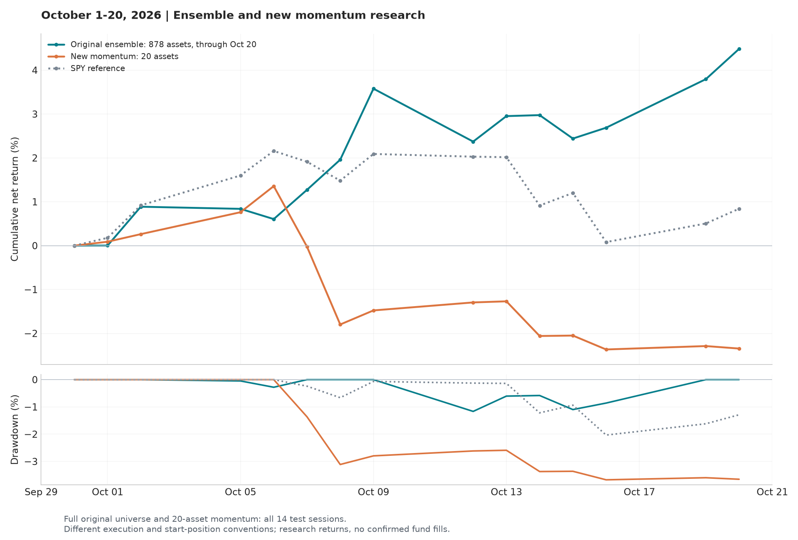

# October 2026 strategy comparison

Requested window: **2026-10-01 through 2026-10-20 inclusive**, 14 XNYS sessions.

All **878 original assets** and **20 momentum assets** have closing marks through October 20. The missing daily bars were recovered from dated closing quote sources; no test return is manufactured by forward filling a missing close. See source notes below.

## October 1-20 results

| strategy                  | start      | end        |   assets |   total_return_pct |   max_drawdown_pct |   annualized_sharpe |
|---------------------------|------------|------------|----------|--------------------|--------------------|---------------------|
| Original dynamic ensemble | 2026-10-01 | 2026-10-20 |      878 |              4.485 |             -1.165 |               6.763 |
| New momentum (20 assets)  | 2026-10-01 | 2026-10-20 |       20 |             -2.346 |             -3.674 |              -4.232 |
| SPY buy-and-hold          | 2026-10-01 | 2026-10-20 |        1 |              0.842 |             -2.033 |               1.221 |



## Method and limitations

- Research simulations only; the fund adapter still records intentions with zero confirmed fills.
- Original ensemble: existing Backtrader strategies and regime allocations, 120 warm-up bars, starts in cash on October 1. Ensemble NAVs blend standalone sleeve returns; no separate allocator turnover fee is modeled.
- Original execution: existing same-close (cheat-on-close) assumption, synthetic high/low at close +/-0.5%, 2 bp slippage, market-specific fees, board lots and short borrow. This is optimistic compared with a tradable next-session simulation.
- Backtrader decimal commission units corrected with percabs=True; the previous fee conversion charged 1/100 of the intended rate. Return accounting includes the starting capital and September 30 benchmark close; inverse-vol weights use prior observations.
- Original 60-day sleeve risk-parity estimator has fewer than 60 trading observations here; its existing 0.01 fallback gives equal sleeve weights throughout the short test.
- New momentum: fixed 50% time-series trend / 50% long-only inverse-volatility core, existing GARCH-t forecasts, 10% target annual volatility, 3x gross cap, lag=2, trading costs and rf+50bp financing above 1x gross. Carries pre-October model positions into the test.
- Removing one holding changes the momentum portfolio. No remaining signal, volatility, trading-band or cost parameters were tuned on October results.
- Momentum weights are continuous research weights without board-lot rounding. Both research engines mix local-currency asset returns without an FX conversion model; normalized results are not fully reconciled USD account returns.
- Own-market holidays are carried forward in momentum; open-market missing quotes are rejected. The ensemble verified subset has observed closes on every SPY session; excluded assets are listed separately.
- Annualized Sharpe and volatility use only 13 or 14 observations and are descriptive, not evidence of persistent performance. SPY excludes benchmark transaction costs.
- Historical caches and pretrained forecasts are supplied research inputs, not an independently audited point-in-time constituent and corporate-action database.
- October 20 recovery: 336 missing daily bars use dated final-session Yahoo quote snapshots, checked against each exchange calendar close and rescaled using the prior close. Their exact prices, timestamps and scaling ratios are saved in data/cache/recovered_close_quotes.json. These are closing marks rather than a complete daily-bar corporate-action audit.
- The missing ES3.SI October 20 close of SGD 5.463 is sourced from https://www.eoddata.com/stockquote/SGX/ES3.htm and matches Yahoo previousClose on October 21. This is an observed end-of-day value, not the last intraday bar. Source details are in data/momentum/recovered_close.json.

## Reproduce from the saved source snapshot

```powershell
.\.venv\Scripts\python.exe scripts/compare_october_strategies.py
```

All engine and ensemble variants are in `comparison.csv`; the saved daily returns, equities, weights, exclusions and SHA-256 manifest make the calculation reviewable.
